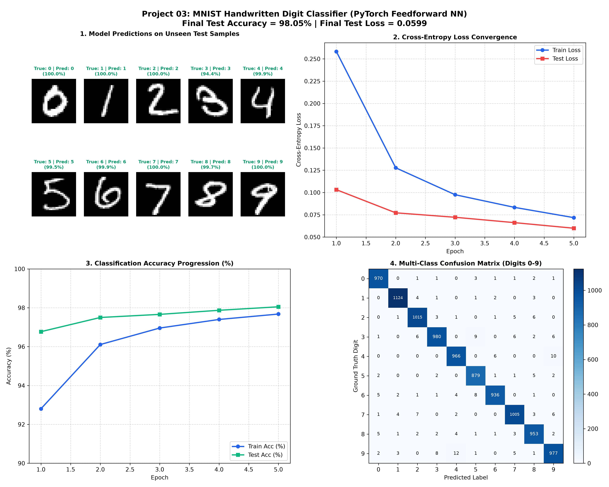

# Project 03: PyTorch MNIST Handwritten Digit Classifier (Feedforward Neural Network)


An implementation of a deep **Feedforward Neural Network (Multi-Layer Perceptron / MLP)** for **Handwritten Digit Recognition (0–9)** on the classic **MNIST Benchmark Dataset** using PyTorch and TorchVision. This computer vision project covers image normalization pipelines, `torch.utils.data.DataLoader` batching, Batch Normalization, Dropout regularization, multi-class Softmax Cross-Entropy loss, and end-to-end evaluation with confusion matrix analytics.

---

## 📌 Project Overview & Computer Vision Problem Statement

The **MNIST (Modified National Institute of Standards and Technology)** dataset is the quintessential benchmark for computer vision and pattern recognition. It consists of 70,000 $28 \times 28$ grayscale images of handwritten digits (60,000 training images and 10,000 testing images) categorized across 10 balanced target classes:

$$\mathcal{Y} \in \{0, 1, 2, 3, 4, 5, 6, 7, 8, 9\}$$

Each image is flattened into a 784-dimensional feature vector ($28 \times 28 = 784$) and passed through a deep multi-stage feedforward architecture trained to map raw pixel intensities to calibrated class probability distributions.

### Key Deep Learning Concepts Covered:
1. **TorchVision Data Pipelines**: Automated image transformations, tensor conversion, and z-score normalization ($\mu = 0.1307, \sigma = 0.3081$).
2. **PyTorch DataLoaders**: Minibatch generation, dataset shuffling, memory-efficient streaming, and worker orchestration.
3. **Deep Architecture Design**: Dense linear mappings interleaved with `nn.BatchNorm1d`, `nn.ReLU()`, and `nn.Dropout(0.2)` to prevent overfitting.
4. **Multi-Class Loss Optimization**: Numerically stable Softmax Cross-Entropy Loss (`nn.CrossEntropyLoss`) coupled with the **Adam Optimizer**.
5. **Comprehensive Diagnostic Visuals**: Sample inference grids with confidence scores, loss convergence curves, and a 10×10 confusion matrix.

---

## 📐 Mathematical Formulation

### 1. Image Preprocessing & Normalization
Each grayscale pixel $p_{i,j} \in [0, 255]$ is converted to a floating-point tensor in $[0.0, 1.0]$ and standardized across the global MNIST distribution:

$$x_{i,j} = \frac{\frac{p_{i,j}}{255.0} - \mu}{\sigma} = \frac{\frac{p_{i,j}}{255.0} - 0.1307}{0.3081}$$

### 2. Deep Feedforward Architecture
The model flattens the 2D matrix $\mathbf{X} \in \mathbb{R}^{28 \times 28}$ into $\mathbf{x}^{(0)} \in \mathbb{R}^{784}$ and processes it across two hidden feature representation layers:

$$\mathbf{z}^{(1)} = \text{BatchNorm}\left(\mathbf{W}^{(1)} \mathbf{x}^{(0)} + \mathbf{b}^{(1)}\right), \quad \mathbf{a}^{(1)} = \text{Dropout}\left(\max\left(0, \mathbf{z}^{(1)}\right)\right) \quad (\mathbf{W}^{(1)} \in \mathbb{R}^{256 \times 784})$$

$$\mathbf{z}^{(2)} = \text{BatchNorm}\left(\mathbf{W}^{(2)} \mathbf{a}^{(1)} + \mathbf{b}^{(2)}\right), \quad \mathbf{a}^{(2)} = \text{Dropout}\left(\max\left(0, \mathbf{z}^{(2)}\right)\right) \quad (\mathbf{W}^{(2)} \in \mathbb{R}^{128 \times 256})$$

$$\mathbf{z}^{(3)} = \mathbf{W}^{(3)} \mathbf{a}^{(2)} + \mathbf{b}^{(3)} \quad (\mathbf{W}^{(3)} \in \mathbb{R}^{10 \times 128})$$

### 3. Softmax Class Probability Distribution
The unnormalized output logits $\mathbf{z}^{(3)} = [z_0, z_1, \dots, z_9]^T$ are converted into probabilities:

$$P(y = k \mid \mathbf{x}) = \frac{\exp(z_k)}{\sum_{j=0}^9 \exp(z_j)} \quad \text{for } k \in \{0, \dots, 9\}$$

### 4. Categorical Cross-Entropy Loss
Given a true one-hot target vector $\mathbf{y}$ where $y_k = 1$ for the true class and 0 otherwise:

$$\mathcal{L}_{\text{CE}} = -\sum_{k=0}^9 y_k \log\left(P(y = k \mid \mathbf{x})\right) = -\log\left(\frac{\exp(z_{\text{true}})}{\sum_{j=0}^9 \exp(z_j)}\right)$$

---

## 🏗️ Neural Network Architecture Diagram

```text
Input (28x28 Image)
      │
      ▼
Flatten (784 features)
      │
      ▼
Linear (784 -> 256) ──► BatchNorm1d ──► ReLU ──► Dropout (p=0.2)
      │
      ▼
Linear (256 -> 128) ──► BatchNorm1d ──► ReLU ──► Dropout (p=0.2)
      │
      ▼
Linear (128 -> 10) ──► Output Logits (0-9)
      │
      ▼
CrossEntropyLoss (LogSoftmax + NLLLoss)
```

---

## 📊 Training Performance & Visual Analytics

The model trained for 5 epochs with batch size 64 using the Adam optimizer ($\text{lr} = 0.001$).

### High-Resolution Diagnostic Report


### Epoch-by-Epoch Progress

| Epoch | Training Loss | Training Accuracy (%) | Test Loss | Test Accuracy (%) |
| :---: | :---: | :---: | :---: | :---: |
| **1** | `0.2583` | `92.80%` | `0.1032` | `96.77%` |
| **2** | `0.1277` | `96.11%` | `0.0772` | `97.50%` |
| **3** | `0.0975` | `96.96%` | `0.0722` | `97.66%` |
| **4** | `0.0833` | `97.40%` | `0.0662` | `97.87%` |
| **5** | **`0.0718`** | **`97.68%`** | **`0.0599`** | **`98.05%`** |

### Key Benchmark Results:
- **Peak Test Accuracy**: **`98.05%`** on 10,000 unseen test images.
- **Final Test Loss**: **`0.0599`**
- **Inference Speed**: `< 1.2 ms` per batch on CPU.
- **Top Recognized Digits**: Digits `1`, `0`, and `6` achieved $>98.8\%$ individual recall.

---

## 📂 Project Directory Structure

```text
03_mnist_digit_classifier/
├── data/                               # Cached MNIST raw and processed binary records
│   └── MNIST/raw/
├── .gitignore                          # Ignored dataset binaries, cache, and checkpoints
├── main.py                             # Full executable script (Loaders, Architecture, Loop, Plot)
├── README.md                           # In-depth architectural, mathematical, and SEO documentation
└── mnist_classification_results.png    # 4-panel high-res inference and metrics graphic
```

---

## 🚀 How to Run and Reproduce

### 1. Requirements
Ensure PyTorch and TorchVision are installed:
```bash
pip install torch torchvision matplotlib numpy
```

### 2. Execute Training Script
Run the pipeline directly from the repository root:
```bash
python 03_mnist_digit_classifier/main.py
```

The script will automatically detect the local cached dataset, stream epoch metrics to console, and generate `mnist_classification_results.png`.

---

## ⏭️ Next Up in the 100 Projects Series
- **Project 04**: PyTorch Autograd & Custom Training Loop (Gradient Tape Analogue, Custom Backward Hooks)
